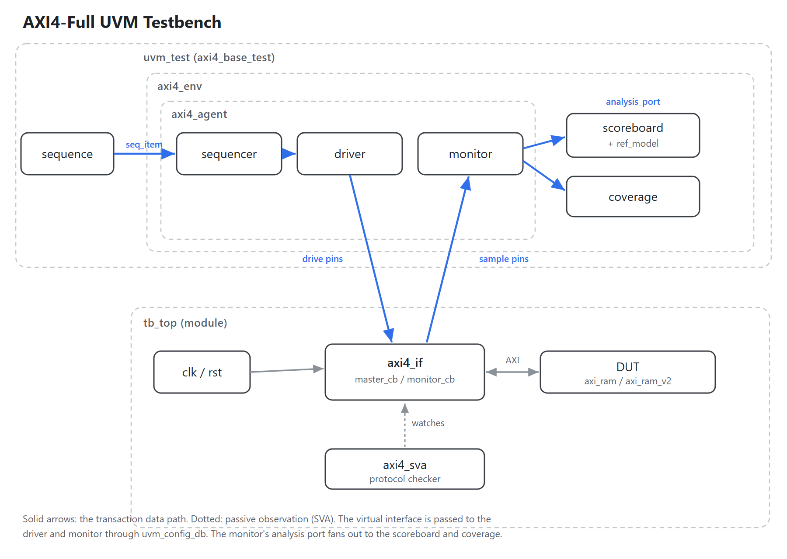
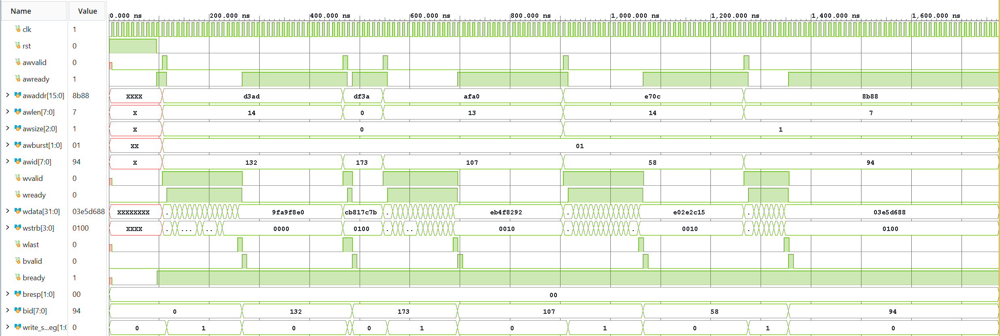

# AXI4-Full UVM Verification

A UVM testbench for an AXI4-Full memory-mapped slave, written from scratch in
SystemVerilog. The environment drives constrained-random and directed AXI
traffic, reconstructs every burst with a passive monitor, and checks the read
data against an independent golden model. It closes 100% functional coverage and
found a real addressing bug in the RTL. A bug-injection campaign then measures
the testbench itself: it catches 25 of 25 deliberately injected RTL bugs, up
from 15 on the first run (see [docs/MUTATION_REPORT.md](docs/MUTATION_REPORT.md)).

The design is simulated with AMD Vivado XSim (Windows and Linux/WSL2) and with
Cadence Xcelium 24.09. A second RTL revision that fixes the bug is checked by the
same tests, so the suite also works as a regression guard.

## Design under test

The DUT is `axi_ram`, an AXI4-Full RAM slave from Alex Forencich's
[verilog-axi](https://github.com/alexforencich/verilog-axi) library (5 channels:
AW, W, B, AR, R). Default configuration is 32-bit data, 16-bit address, 8-bit ID.
It uses one FSM for the write path and one for the read path.

`Axi_ram_v2.v` is a second revision that fixes the WRAP addressing bug described
below and adds a queue-based front end for multiple outstanding transactions.
Both revisions share the same port list, so a single testbench targets either one.

Known limitations of the original RTL (verification targets): WRAP bursts are
addressed like INCR, and the response codes are hardwired to OKAY.

## Architecture



| Component | Purpose |
|-----------|---------|
| `axi4_seq_item` | One AXI burst: address, control, data and strobe arrays. Constrained for legal traffic (4 KB boundary, size alignment, WRAP lengths). |
| `axi4_driver` | AXI master. One thread per channel, so several bursts can be in flight; write drives AW and W concurrently, then collects B. |
| `axi4_monitor` | Passive. Rebuilds write and read bursts from the pins and broadcasts them on an analysis port. Handles overlapping bursts through per-phase FIFOs. |
| `axi4_ref_model` | Golden byte-addressable memory, independent of the RTL. Models write strobes, narrow transfers, and correct FIXED/INCR/WRAP addressing. |
| `axi4_scoreboard` | Subscribes to the monitor. Writes update the model; reads are compared byte by byte against it. |
| `axi4_coverage` | Second monitor subscriber. Samples a covergroup and prints a per-coverpoint report. |
| `axi4_agent`, `axi4_env` | Standard UVM containers for the agent (sequencer/driver/monitor) and the environment (agent, scoreboard, coverage). |
| `axi4_sva` | Protocol assertions bound into the testbench without touching the RTL. |

The monitor's analysis port fans out to two subscribers: the scoreboard answers
"is the data correct", coverage answers "was it exercised". See
[docs/ARCHITECTURE.md](docs/ARCHITECTURE.md) for the full diagram and the life of
a transaction.

## Repository layout

```
rtl/
  axi_ram.v            DUT revision 1 (original, has the WRAP bug)
  Axi_ram_v2.v         DUT revision 2 (WRAP fixed, outstanding support)
tb/
  axi4_if.sv           AXI4 interface with clocking blocks and modports
  axi4_sva.sv          SVA protocol checker (bound into tb_top)
  axi4_pkg.sv          package: parameters, enums, class includes
  tb_top.sv            top: interface + DUT + run_test()
  uvm/                 sequence item, agent, driver, monitor, ref model,
                       scoreboard, coverage, env, sequences, tests
sim/
  judge.py             pass/fail rule for one run, shared by both regressions
  run_xsim.bat         Vivado XSim flow (Windows)
  Makefile             Vivado XSim flow (Linux / WSL2)
  wave*.tcl            waveform setups (all / write-path / read-path)
  run.bat              Questa compile check
  xcelium/             Cadence Xcelium flow: Makefile, regress.py, mutate.py
dpi/
  axi4_ref_model.c     golden memory in C
  dpi_demo_tb.sv       DPI-C demonstration
docs/
  ARCHITECTURE.md      block diagram, transaction flow, design notes
  PROJECT_LOG.md       development log, findings, cheat sheets
```

## Running

Linux (WSL2), using the Makefile:

```
source /tools/Xilinx/<version>/Vivado/settings64.sh
cd sim
make                          # default test
make TEST=axi4_wrap_test DUT=v2
make regress SEEDS="1 2 3"    # multi-seed regression (v1)
make regress DUT=v2           # same, against Axi_ram_v2
make gui                      # waveforms (WSLg)
```

Cadence Xcelium, from `sim/xcelium`:

```
make                                  # default test, v1
make TEST=axi4_wrap_test DUT=v2 SEED=7
make XPROP=C                          # X-propagation build
make regress                          # python3 regress.py: 9 tests x 5 seeds x both DUTs
python3 regress.py -s 1 7 42 -d v2    # other seeds / one DUT
python3 regress.py -x C -j 8          # X-propagation build, 8 runs at a time
make mutate                           # python3 mutate.py: bug-injection campaign
```

Windows, using the batch script:

```
call "C:\AMDDesignTools\<version>\Vivado\settings64.bat"
cd sim
run_xsim.bat
run_xsim.bat axi4_wrap_test v2
run_xsim.bat axi4_base_test gui wr   :: write-path waveforms
```

A run passes when it reaches the end of the test (`END_OF_TEST`, printed in
`report_phase`) with `UVM_ERROR : 0`, `UVM_FATAL : 0` and no simulator error.
Checking errors alone is not enough: a `uvm_fatal` still prints
`UVM_ERROR : 0` in its summary. Assertion failures are reported as
`UVM_ERROR`s, so they fail the run like a scoreboard mismatch. The rule lives in
`sim/judge.py` and both regressions use it; each run keeps its own log, and
`regress.py` also writes a JUnit `results.xml`.

## Tests

| Test | Description |
|------|-------------|
| `axi4_base_test` | random write followed by a read-back of the same region |
| `axi4_write_test`, `axi4_read_test` | single-direction traffic |
| `axi4_rand_test` | mixed random read/write |
| `axi4_directed_test` | corner cases: single beat, max burst, 4 KB edge, narrow, FIXED |
| `axi4_cov_test` | coverage closure: deterministic sweeps plus a random mix |
| `axi4_outstanding_test` | pipelined bursts; reports peak concurrency on the bus |
| `axi4_stress_test` | 8 bursts in flight (more than v2's queues hold), BREADY/RREADY high only 30% of cycles |
| `axi4_wrap_test` | reproduces the WRAP bug: expected failure (XFAIL) on v1, regular test on v2 |

Add `v2` to any command to target `Axi_ram_v2` instead of `axi_ram`.

## Results

Clean regression on both revisions reports zero errors and zero byte mismatches.
The one intended exception is `axi4_wrap_test`. On revision 1 the regression runs
it as an expected failure, so it reports a problem if the test ever stops
catching the bug. On revision 2 it runs as a regular test and guards the fix.

On Xcelium the full regression runs 90 simulations (9 tests × 5 seeds × 2
revisions) in about 30 s, all with the expected result. The same is true with
`-xprop C`.
Xcelium also reproduces the headline numbers independently: 24 byte mismatches
in `axi4_wrap_test` on revision 1, and outstanding peaks of 2 on revision 1 and
4 on revision 2.

### Testing the testbench: mutation campaign

`sim/xcelium/mutate.py` injects one bug at a time into `Axi_ram_v2.v` and
reruns the regression. It uses 25 mutants across address generation, the data
path, burst length and LAST, response codes and IDs, and queue and READY flow
control. The first run killed 15 (60%). The 10 survivors showed three things
the testbench never did:

- it never checked response codes or IDs;
- it never stalled BREADY or RREADY;
- it never had more bursts in flight than the slave's queues hold.

After adding the response checks, ID-ordering and stability assertions, random
back-pressure and `axi4_stress_test`, it kills all 25. Details are in
[docs/MUTATION_REPORT.md](docs/MUTATION_REPORT.md).

A four-beat write burst on the bus:



### Bug found: WRAP bursts addressed like INCR

The original RTL increments the address linearly on every burst type except
FIXED, so a WRAP burst never wraps inside its window and later beats land past
the end of it.

A write-then-read-back test using WRAP on both sides does not catch this: the DUT
is wrong the same way when it writes and when it reads, so it reads back from the
same wrong places it wrote to and the data appears to match. The failing case only
shows up with an asymmetric check, writing with WRAP and reading the same window
back with INCR:

```
WRAP write at 0x0A08, 4 beats x 4 B   (window 0x0A00..0x0A0F)
  correct : 0x0A08, 0x0A0C, 0x0A00, 0x0A04
  DUT     : 0x0A08, 0x0A0C, 0x0A10, 0x0A14   (runs past the window)
```

Reading the window back with INCR shows 0x0A00 and 0x0A04 returning zero, which
the scoreboard flags as 24 byte mismatches. `Axi_ram_v2` computes the wrap
address correctly and passes the same test.

### Outstanding transactions

The driver is pipelined and `max_outstanding` sets how many bursts may overlap.
It counts how many were actually concurrent on the bus. Revision 1 peaks at 2
(its FSM raises AWREADY in the same cycle it asserts BVALID), while `Axi_ram_v2`
sustains the full depth of 4.

### Functional coverage

`axi4_cov_test` reaches 100% on every seed (122 bursts; on Xcelium seed 1,
278 beats checked). Coverpoints cover direction, burst type, transfer size,
burst length, 4 KB region, strobe pattern and WRAP start position, with crosses
on burst-by-size, burst-by-length and direction-by-burst.
Constrained-random stimulus alone plateaued at 98.3%; directed sweeps closed the
remaining bins.

The first 100% was a single seed on XSim, and it did not hold. On Xcelium only 5
of 12 seeds reached 100%: the 4 KB region and strobe-pattern bins were left to
the random mix, and it did not always reach them. Directed sweeps now cover
every region and every strobe shape, so closure no longer depends on the seed. Structurally unreachable bins (single-beat WRAP, and error
responses the DUT cannot produce) are excluded with `ignore_bins` and a comment,
rather than left as open holes.

Coverage of the burst encoding turned out to be weaker than it looked. The
coverage test reached 100% on revision 1, the buggy one, including every WRAP
bin. Every directed WRAP burst started on its window base, and a WRAP burst that
starts there has the same addresses as INCR, so it never wraps. `cp_wrap_pos`
now records whether a WRAP burst starts on the window base or mid-window, and
the sweep includes a burst that really wraps. Coverage still cannot replace the
check: the sweep reads back with WRAP, and only `axi4_wrap_test`'s INCR
read-back exposes the bug.

## Protocol checking (SVA)

`tb/axi4_sva.sv` is a standalone checker bound into the testbench. It covers the
handshake rules (VALID held until READY, payload stable while stalled), reserved
burst encodings, transfer size against the bus width, unknown values on qualified
fields, WLAST/RLAST landing on the beat implied by the length, no B before
WLAST, and BID/RID matching the oldest open request (both DUTs complete in
order). There are 38 assertions in all. The assertions
were validated by inverting one and confirming it fired the expected number of
times, so a passing run means the checks are actually active rather than vacuous.
Failures are reported through the UVM report server (`uvm_report_error`) rather
than `$error`, so they count toward `UVM_ERROR` and fail the regression.

## C reference model over DPI-C

`dpi/` contains the scoreboard's golden memory written in C and called from
SystemVerilog through DPI-C. The SystemVerilog side keeps the AXI addressing and
byte-lane logic; the C side owns the storage. `dpi_demo_tb.sv` is a self-contained
demonstration of write-strobe masking and narrow-transfer word folding checked
against the C model. It runs on Synopsys VCS and Siemens Questa (verified on EDA
Playground) and on Vivado XSim for this small case. See [dpi/README.md](dpi/README.md).

## Tooling notes

The main environment runs on the free Vivado XSim tier. Two things do not work on
that tier and are handled accordingly: the `xcrg` HTML coverage report needs a Pro
license, so coverage is reported from the SystemVerilog coverage API instead; and
DPI-C combined with the full UVM build hits an XSim code-generation defect (the
DPI wrapper is emitted as C++ but compiled as C), so the DPI-C work is kept in the
separate `dpi/` demo that runs on VCS and Questa.

On Xcelium, covergroups are only sampled with `-coverage U`; without it every
coverpoint reads 0% and the run still passes, so the flag is in `xrun.args`. On
the lab host every run reports `*E,IMPDLL` (no glibc-devel for the DPI export
stub), which does not affect batch results and is the one simulator message
`judge.py` tolerates. Xcelium also reports each failed assertion as
`*E,ASRTST`, alongside the checker's own `[AXI_SVA]` error.

## License and attribution

`rtl/axi_ram.v` is from Alex Forencich's verilog-axi project under the MIT
License; the original copyright header is kept in the file. `Axi_ram_v2.v` is a
derivative of that module and carries the same notice. The UVM environment, the
SVA checker, the C reference model, the build scripts and the documentation were
written for this project.
