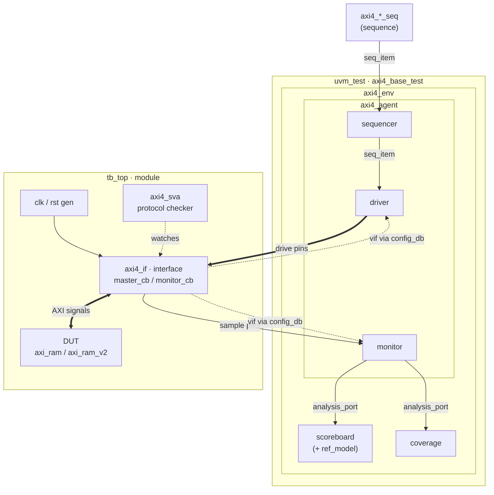
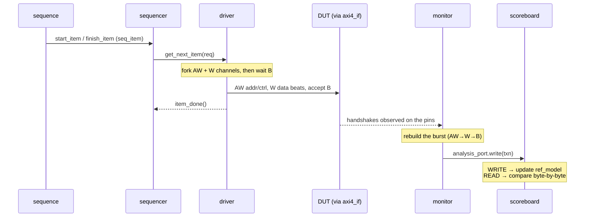

# UVM Testbench Architecture

## Structure & data flow



Solid arrows = the transaction data path. Dotted = setup (the virtual
interface handed down through `uvm_config_db`) and the passive SVA checker.
Note the monitor's analysis port fans out **1→N**: the same observed
transaction feeds both the scoreboard (is it correct?) and coverage (did we
exercise it?).

## Life of one write transaction



## Component responsibilities

| Component | Base class | Role |
|-----------|-----------|------|
| `axi4_seq_item` | `uvm_sequence_item` | One AXI burst (write or read): addr/ctrl + data[]/strb[] + resp. Randomizable. |
| `axi4_agent_cfg` | `uvm_object` | Knobs: the virtual interface handle + active/passive. |
| `axi4_sequencer` | `uvm_sequencer` | Arbitrates sequences and hands items to the driver (a typedef). |
| `axi4_driver` | `uvm_driver` | Pulls items from the sequencer and wiggles the AXI pins per protocol. |
| `axi4_monitor` | `uvm_monitor` | Passively watches the pins, rebuilds transactions, broadcasts them. |
| `axi4_agent` | `uvm_agent` | Container: sequencer + driver + monitor. Active drives; passive only watches. |
| `axi4_ref_model` | `uvm_object` | Golden byte-granular memory. Models *correct* AXI addressing (incl. real WRAP) and write strobes. |
| `axi4_scoreboard` | `uvm_scoreboard` | Subscribes to the monitor: writes update the model, reads are compared byte-by-byte against it. |
| `axi4_coverage` | `uvm_subscriber` | Second monitor subscriber; samples the functional covergroup and prints a per-coverpoint report. |
| `axi4_env` | `uvm_env` | Container for the agent + scoreboard + coverage. |
| `axi4_*_seq` | `uvm_sequence` | Stimulus programs: what transactions to generate. |
| `axi4_base_test` | `uvm_test` | Top of the hierarchy: builds env, wires cfg, launches a sequence. |

## Key UVM mechanisms used

- **Factory** (`type_id::create` + `uvm_*_utils`): objects/components are created
  through a registry so tests can override types without editing the env.
- **Phases** (`build_phase` → `connect_phase` → `run_phase`): build top-down,
  connect bottom-up, then run in parallel time-consuming threads.
- **`uvm_config_db`**: passes the virtual interface and the cfg object down the
  hierarchy without hard-coded paths.
- **TLM**:
  - sequencer↔driver via `seq_item_port`/`seq_item_export`
    (`get_next_item` / `item_done`);
  - monitor→subscribers via `uvm_analysis_port` (`ap.write()`).
- **Objections**: the sequence/test raises an objection during `run_phase` so the
  simulation stays alive until the stimulus is done, then drops it to finish.

## AXI protocol notes baked into the driver/monitor

- Write: drive **AW** and **W** channels concurrently (`fork`), because the DUT
  only raises `wready` after it has accepted `AW`. Collect **B** at the end.
- Read: drive **AR**, then accept **R** beats until `rlast`.
- Handshake rule: hold `*valid` + payload stable until `*ready` is sampled high
  on a rising clock edge.
- DUT quirks:
  - `bresp`/`rresp` are hardwired to `OKAY` — the DUT can never report an error.
  - **`WRAP` bursts are treated like `INCR`** (address incremented linearly, never
    wrapped). **Confirmed by the Week 4 scoreboard** — see `axi4_wrap_test`.

## Checking strategy — why the WRAP bug needs an asymmetric test

A WRAP write followed by a WRAP read-back of the same region **passes even
though the DUT is broken**: the DUT is consistently wrong on both sides, so it
reads back from exactly the (wrong) addresses it wrote to, and the reference
model is consistently right on both sides. Both are self-consistent, so the data
agrees.

`axi4_wrap_seq` therefore writes with **WRAP** and reads the whole window back
with **INCR**, which reveals where the bytes physically landed:

```
WRAP write @0x0A08, 4 beats x 4B   (window 0x0A00..0x0A0F)
  correct : 0x0A08, 0x0A0C, 0x0A00, 0x0A04   <- wraps
  DUT     : 0x0A08, 0x0A0C, 0x0A10, 0x0A14   <- keeps incrementing
INCR read back over 0x0A00..0x0A0F
  -> 0x0A00 / 0x0A04 read as 0x00 from the DUT, mismatch vs. the model
```

General lesson: a self-consistent read-back can mask an addressing bug. Check
against an independent model, and cross-check with a *different* access pattern
than the one used to write.
